# Kế hoạch xử lý yêu cầu Backend bổ sung ngày 13 tháng 11 năm 2026

Trạng thái 14/11/2026: **A/B đã commit 26398e6; C–F đã triển khai code và smoke HTTP kho PASS trên DB tạm. G đã có bản bàn giao FE, nguồn AI và dự thảo Word/điều khoản.** Chưa chạy CI GitHub của cụm mới, chưa deploy DB/Docker chính, chưa sửa Word gốc/publish điều khoản hoặc UAT FE/Gemini thật.

Cụm 1 ở nhánh `feat/toantran/review-publishing-privacy`, base `04bb072` (bản vá CI của PR #106). Đã commit 26398e6. API và điểm cần FE cập nhật: [REVIEW_PUBLISHING_PRIVACY_API.md](REVIEW_PUBLISHING_PRIVACY_API.md). Checklist hiện hành: [IMPLEMENTATION_CHECKLIST.md](../IMPLEMENTATION_CHECKLIST.md).

Đã xác minh: build Host, Privacy console, model EF sạch, migrations/seed trên PostgreSQL CI mới; hồi quy ABP/JWT/catalog/vòng đời đơn/actual-weight; keyword privacy và review publishing qua HTTP. Test Publish/Hide cạnh tranh trả 200/409, replay không trùng audit và aggregate khớp. Container CI đã dọn. Migration mới: `20261113094800_AddRatingContentApproval`; kiểm tra DB local trước backfill có 1 rating, 0 nội dung đã phát hành. Docker local bản cuối đã chạy, Swagger HTTP 200 có API Publish, migration đã áp dụng vào washgo_main và số rating giữ nguyên 1; DB được sao lưu vào Temp ngoài repo trước triển khai.

Phần đối chiếu source ở mục 2 dưới đây là **kết quả rà ban đầu trước cụm 1**, giữ để giải thích nguồn công việc; không dùng cột “khoảng trống” đó thay cho checkbox hiện tại. Bản rà ban đầu dùng HEAD `fb31020`; chưa làm Word/FE hoặc quy trình kho mới trong cụm này.

## 1. Các file đã đọc

Nguồn chính là 7 file mới trong `washgo-be/cần làm`, không phải 13 tài liệu cũ ở `C:/Users/PC/Desktop/HK1_2027/cần làm`:

1. [BACKEND_ADMIN_REVIEW_MANAGEMENT.md](../cần%20làm/BACKEND_ADMIN_REVIEW_MANAGEMENT.md)
2. [BACKEND_CUSTOMER_REVIEW.md](../cần%20làm/BACKEND_CUSTOMER_REVIEW.md)
3. [BACKEND_SHIPPER_DASHBOARD_PROFILE.md](../cần%20làm/BACKEND_SHIPPER_DASHBOARD_PROFILE.md)
4. [BACKEND_ADMIN_STORAGE_TRANSFER.md](../cần%20làm/BACKEND_ADMIN_STORAGE_TRANSFER.md)
5. [BACKEND_MERCHANT_STORAGE_TRANSFER.md](../cần%20làm/BACKEND_MERCHANT_STORAGE_TRANSFER.md)
6. [BACKEND_SHIPPER_DELIVERY_TASKS.md](../cần%20làm/BACKEND_SHIPPER_DELIVERY_TASKS.md)
7. [BACKEND_CUSTOMER_STORAGE_RETURN.md](../cần%20làm/BACKEND_CUSTOMER_STORAGE_RETURN.md)

Hai tài liệu FE được các file trên nhắc đến (`BACKEND_SYNC_2026_11_12.md`, `SHIPPER_PROGRESS.md`) hiện không có trong thư mục yêu cầu này; chưa dùng chúng làm bằng chứng FE đã nghiệm thu. Không viết lại nội dung yêu cầu gốc để thay trạng thái triển khai.

## 2. Kết quả đối chiếu với code

| Nhóm | Đã có, cần giữ và tái sử dụng | Khoảng trống xác minh được |
|---|---|---|
| Đánh giá | Admin filter/summary/detail, Hide/Show, batch tối đa 50, version/operation lookup/audit; DTO Customer/Partner tách riêng | Admin DTO chưa có bộ contact yêu cầu; chưa có Publish riêng; Show bản đang visible trả Unchanged, không duyệt nội dung |
| Bộ lọc Partner | Scope Merchant và visible rating, DTO giấu comment/media chưa duyệt | `FilterAsync` vẫn tìm theo Comment chưa phát hành, gây suy luận qua count/list |
| Ẩn danh đơn | Staff đã bị che tên/SĐT/mã Customer ở nhiều response | Nhánh Customer trong `RedactStaffData` chưa bỏ Merchant/Shipper identity và actor; media vẫn nạp Merchant phone/images; cần kiểm tra mọi đường xuất dữ liệu |
| Shipper self-status | Profile revision/operation, dashboard, task/credentials và phân công có check Available | Chưa có endpoint tự Available/Offline; profile update không nhận status/isActive |
| Chuyển kho | `move-to-storage`, tính phí locker/kho, metadata kho dạng chuỗi, guard theo đơn | Một bước chuyển thẳng ReadyToReturn → MovedToStorage và giải phóng ô; chưa có phân công/đã lấy/đã bàn giao độc lập |
| Lưu kho tại tiệm | Merchant và địa chỉ cửa hàng đã có | Bổ sung mốc vào/ra, phí và lịch sử giao nhận theo vòng; không cần registry kho riêng |
| Đồ đang lưu kho | MovedToStorage, tiền giặt/phí kho, Customer pickup-storage | Chưa có yêu cầu giao lại locker; pickup-storage cho Customer tự xác nhận nhận tại kho, trái hướng mới |
| Nhiệm vụ/lịch sử | DeliveryTask, snapshots, replay, dashboard/history, task PIN/QR | Enum chỉ Collect/Return; chưa có StorageTransfer/StorageReturn hoặc các bước vận chuyển kho |
| Thông báo/biên lai/AI | Các nguồn đang phục vụ luồng cũ | Một số thông báo kho có địa chỉ kho/tên tiệm và mời nhận tại kho; biên lai có mã tiệm; hướng dẫn AI còn nói nhận tại kho, cần đồng bộ |

### Điểm source đã kiểm tra trực tiếp

- `RatingAppService.FilterAsync`: keyword Comment không có điều kiện phát hành đối với Merchant.
- `RatingAppService.SetVisibilityAsync`, `ToAdminDto`, `ToPartnerDto`: `ContentReleased = !IsHidden && ModeratedAt != null`, `CanShow = IsHidden`; ToAdminDto chưa enrich contact hiện tại.
- `WashOrderAppService.RedactStaffData`: Customer chỉ bị xóa task credential/ShipperNote, chưa che đối tác/timeline theo yêu cầu mới.
- `OrderMediaEnricher.FillAsync`: ảnh/liên hệ Merchant có thể được gán vào DTO đơn; cần lọc theo role tại nguồn và projection cuối response.
- `WashOrderAppService.MoveToStorageAsync`: giải phóng ô, chốt phí và đổi trạng thái trong một lần ghi; kho là chuỗi client nhập.
- `UnpaidOrderStorageMover`: tự ghi MovedToStorage sau hạn thanh toán tại tiệm; cần bổ sung lịch sử lưu kho theo vòng, không cần WarehouseId.
- `NotificationPublisher`: thông báo trả tiền/chuyển kho còn chứa StorageLocation và hướng khách tới kho. Đây là chỗ đã thấy trong source, không chỉ là rủi ro giả định.
- `ReceiptPdfRenderer`: biên lai có MerchantOrderCode; phải đánh giá lại theo chính sách ẩn danh mới.
- `DeliveryTaskType`, `DeliveryTaskRules.ActiveAssignments`: chỉ luồng Collect/Return; mọi guard bận, task filter/summary/dashboard cần mở rộng đồng bộ khi có task kho.

Đây là rà source, chưa có HTTP regression mới trong lượt lập plan này. Các đường chưa đọc đầy đủ như mọi file media/biên nhận cache phải được kiểm tra ở chặng tương ứng; không mặc định tất cả đều đang rò rỉ.

## 3. Nghiệp vụ đã chốt và quyết định còn mở

### Đã chốt trong yêu cầu và phản hồi người dùng

- Kho chính là khu lưu đồ tại tiệm Merchant đang xử lý đơn. Dùng địa chỉ tiệm sẵn có; không tạo registry, WarehouseId hoặc CRUD kho riêng. Lưu snapshot địa chỉ theo chuyến để thay đổi hồ sơ không làm đổi lịch sử.
- Merchant điều phối Shipper của mình; Admin giám sát/hỗ trợ có lý do và audit, không nhận vai người đi lấy/giao trong luồng thường.
- Customer làm việc với WashGo, nhận lại tại locker sau yêu cầu trên hệ thống, không tự đến kho Merchant nhận.
- Không có IoT/cảm biến/callback cửa; QR/PIN và các bước lấy/bàn giao là xác nhận mô phỏng.
- Phân công không giải phóng ô; xác nhận đã lấy mới giải phóng. Chỉ xác nhận bàn giao mới coi đã ở kho.
- Customer không thấy danh tính/liên hệ Merchant/Shipper hoặc địa chỉ kho; đối tác không nhận danh tính/liên hệ Customer. Admin có quyền nội bộ.
- Phản hồi ngày 13/11: **Shipper xác nhận bàn giao kèm biên nhận; Merchant giám sát**, không bổ sung bước Merchant duyệt nhận hàng riêng trong luồng thường. Biên nhận ở đây là mã/thông tin bàn giao do người thực hiện ghi nhận, không phải bằng chứng phần cứng.

### Phương án người dùng đã chốt ngày 13/11/2026

Người dùng đồng ý phương án sau phần giải thích về self-status và giao lại từ kho:

- Shipper tự chuyển Available/Offline; Offline vẫn đăng nhập/xem lịch sử nhưng không nhận phân công mới. Chặn chuyển Offline khi còn nhiệm vụ hiệu lực; không tự sửa Busy thủ công hoặc trạng thái nhân sự.
- Không thu thêm phí vận chuyển kho → locker trong bản đầu. Các khoản phí kho/locker đã phát sinh vẫn phải thanh toán.
- Dừng phí locker khi xác nhận lấy khỏi locker; bắt đầu phí kho khi xác nhận bàn giao vào kho và dừng khi xác nhận xuất kho. Thời gian vận chuyển không tính thành phí lưu kho.
- Khi đồ được đặt lại vào locker, bắt đầu 24 giờ nhận miễn phí mới; bảo toàn các khoản phí của vòng trước. Giữ mức phí kho 100.000đ/ngày và quy tắc làm tròn hiện hành.
- Shipper xác nhận bàn giao vào kho kèm biên nhận; Merchant giám sát.

Đây là quyết định nghiệp vụ để triển khai, chưa phải xác nhận code đã hoàn thành.

### SLA nhiệm vụ kho đã chốt ngày 13/11/2026

| Nhiệm vụ | Thời hạn đã chốt | Hệ quả |
|---|---|---|
| Locker → tiệm | 4 giờ từ lúc phân công đến khi xác nhận bàn giao tại tiệm | Trễ thì cảnh báo và ghi lịch sử; vẫn cho lấy/bàn giao |
| Tiệm → locker | 24 giờ từ lúc Customer gửi yêu cầu giao lại hợp lệ đến khi đặt đồ vào locker thành công | Bao gồm thời gian chờ phân công; trễ thì cảnh báo và ghi lịch sử, vẫn cho giao nhận |

SLA không phải phí của Customer, không tự trừ lương/phạt tiền Shipper và không thay đổi công thức phí lưu kho. Phân công lại không làm đặt lại mốc SLA của chuyến đang thực hiện; lưu mốc bắt đầu/hạn theo chuyến để không che thời gian trễ. Các giá trị này đã được người dùng đồng ý và đã triển khai trong cụm kho C–F; không reset hạn do phân công lại.

Ví dụ cách hiểu phí đã chốt: khách yêu cầu nhận lại lúc 10h, Shipper xác nhận xuất kho lúc 14h thì phí kho vẫn tính đến 14h. Đồ vào locker lúc 15h thì hạn nhận miễn phí mới bắt đầu từ 15h; không tính giờ vận chuyển thành phí kho. Ngày lưu kho vẫn làm tròn theo chu kỳ hiện hành, không tự đổi đơn giá 100.000đ/ngày.

Chưa cần chốt tên enum/endpoint với người dùng nếu không làm thay đổi hành vi; BE chịu trách nhiệm hợp đồng rõ ràng. Nhưng không tự đặt tiền, miễn/hoàn phí hoặc trách nhiệm hàng hóa khi chưa thống nhất.

## 4. Thứ tự thực hiện đề xuất

1. **Chặng A: Ẩn danh response và khép bộ lọc Partner.** Đây là lỗi kiểm soát dữ liệu, không cần đợi quyết định kho.
2. **Chặng B: Admin contact và Publish đánh giá.** Sửa luồng duyệt rõ ràng, không buộc ẩn/hiện giả.
3. **Chặng C: Shipper tự Available/Offline**, phạm vi đã được người dùng chốt.
4. **Chặng D: Thiết kế lưu kho tại tiệm và schema**, gồm mốc vào/ra, phí, trạng thái giao nhận và legacy; không có CRUD kho riêng.
5. **Chặng E: Locker → kho**, phân công, xác nhận lấy và bàn giao.
6. **Chặng F: Kho → locker theo yêu cầu Customer**, chốt phí/ô/mã mới.
7. **Chặng G: Hồi quy toàn luồng, đồng bộ Word/điều khoản/hướng dẫn AI và bàn giao FE.**

Theo yêu cầu tối ưu mới: build/test sát phần sửa; hồi quy rộng qua CI. Chỉ rebuild Docker chính khi cần nghiệm thu Swagger/deploy, không tự sửa DB chính mỗi vòng code. Không tick hoàn thành chỉ vì đã có endpoint. Các chặng kho phụ thuộc nhau; không mở UI chức năng mới khi chỉ có schema hoặc endpoint đơn lẻ.

## 5. Chặng A Ẩn danh và bộ lọc Partner

- [x] Ma trận field/role tại REVIEW_PUBLISHING_PRIVACY_API.md: public order code, service, locker và tài chính nào cần cho tác nhân; tách nội bộ Admin khỏi Customer/Partner.
- [x] Dùng projection Customer theo allowlist hoặc redactor chung đặt tại biên trả response; bỏ Merchant/Shipper IDs, tên, ảnh, email, phone, mã tiệm, địa chỉ kho và actor identity tương ứng. Không làm mất mã nhận đồ của chính Customer ở endpoint được phép.
- [x] Staff không nhận CustomerId/contact/avatar/free text PII; giữ dữ liệu vận hành tối thiểu và liên kết nội bộ cho Admin.
- [x] Áp dụng sau enrich cho list/detail và mọi mutation response, version-conflict payload, replay, order operation lookup. Không chỉ sửa một mapper hoặc chỉ ẩn field trên FE.
- [x] Snapshot operation cũ cũng phải qua projection role khi đọc. Không xóa hàng loạt hoặc regex thay chuỗi trong ledger để giả lập ẩn danh.
- [x] Rà receipt, notification payload/text/template, media, storage reference và nguồn chatbot; với nội dung legacy thiếu dữ liệu tái dựng thì trả thông điệp WashGo chung, không phát lại địa chỉ kho/nội dung nội bộ cho Customer.
- [x] Sửa Partner keyword theo điều kiện phát hành hiện tại (`!IsHidden && ContentApprovedAt != null`); count/list dùng cùng query. Không mở tìm theo mã đơn/Customer. Build/Docker/smoke HTTP PASS, cleanup đã xác minh. Chặng B đã chuyển predicate sang ContentApprovedAt cho cả query và DTO.
- [x] Test HTTP theo role, chủ đơn khác, hidden/unreviewed/approved rating và từ khóa độc nhất nằm trong comment chưa phát hành.

Nghiệm thu: Admin giữ được dữ liệu cần thiết; Customer/Partner không lộ identity qua response hoặc suy luận keyword/count. Không khẳng định có thể thu hồi file/email người dùng đã tải/nhận trước đó.

## 6. Chặng B Admin contact và phát hành nội dung đánh giá

- [x] Thêm các field Admin yêu cầu: customerAvatarUrl/customerEmail/customerPhoneNumber, merchantImageUrls/merchantEmail/merchantPhone; metadata basis và thời điểm tra cứu.
- [x] Enrich theo batch từ hồ sơ hiện tại, không N+1; thiếu/xóa tài nguyên trả null/[], không tạo ảnh/phone giả. Phân biệt tên snapshot trên rating với contact hiện tại.
- [x] Chỉ DTO Admin và service/endpoint có quyền Admin được nạp contact; không đưa vào Partner/Customer DTO, summary hoặc lỗi của role khác.
- [x] Triển khai thao tác **Publish** riêng với `CanPublish`, reason code, expectedVersion, operationId và lookup. Giữ Hide/Show là điều khiển hiển thị.
- [x] Tách dữ liệu phê duyệt nội dung khỏi thời điểm Hide/Show; không dùng mọi ModeratedAt làm bằng chứng Admin đã duyệt PII.
- [x] Publish bản đang visible chưa duyệt không tạo lịch sử Hide/Show giả. Hide chặn phát hành; Show chỉ phát lại nếu đã có phê duyệt nội dung hợp lệ.
- [x] Batch Publish tối đa 50, outcome từng mục theo executor/guard hiện có, audit đúng actor; stale/concurrent/replay không ghi trùng.
- [x] Publish không tự tăng/giảm aggregate sao vì không đổi visibility. Tiếp tục cập nhật aggregate theo Hide/Show hiện có.
- [x] Admin review nhận xét/media trước phát hành, có lưu vết; không hứa regex tự chứng minh ảnh/video không có PII và không sửa nội dung Customer âm thầm.
- [x] Migration giữ trạng thái đã thực sự phát hành theo logic cũ; bản hidden hoặc không có đủ bằng chứng không mặc định approved. Cần báo cáo dữ liệu legacy trước backfill.

Nghiệm thu: rating mới visible có thể được Publish ngay; Merchant chỉ đọc comment/media đã phát hành, kể cả khi dùng keyword; contact chỉ có cho Admin. Test đơn lẻ, batch, missing profile, version/replay và race Hide/Publish.

Kiểm chứng cụm 1: `Privacy` console và `review-publishing.ps1` PASS trên image mới/DB CI; có list/detail theo quyền, foreign-owner 404, chống suy luận qua filter, conflict payload, receipt/inbox, contacts/missing profile, Publish/Hide/Show, batch/limit/replay/lookup/race và aggregate. Riêng snapshot legacy Shipper kiểm thử qua helper thực tế dùng bởi cả replay và lookup; chưa là nghiệm thu E2E FE. Chatbot đã dùng allowlist dữ liệu đơn không có identity; sửa hướng dẫn nhận ở kho theo quy trình mới vẫn thuộc chặng G. Không thu hồi được file/email đã tải trước bản sửa.

## 7. Chặng C Trạng thái làm việc Shipper đã chốt

Giải thích nghiệp vụ: Available là nhận phân công mới, Offline là tạm không nhận phân công. Offline không phải khóa tài khoản; không thay User.IsActive/Shipper.IsActive hoặc Merchant phụ trách. Trạng thái Busy cá nhân và tải nhiệm vụ suy ra từ đơn không được ghi đè tự động.

- [x] Endpoint đề xuất `PUT /shipper-profile/work-status`, chỉ Shipper hiện đăng nhập; command chỉ status, expectedRevision, operationId, không nhận shipperId/merchantId.
- [x] Capability và reason từ server; trạng thái đích chỉ Available/Offline. Chặn nếu hồ sơ/tài khoản nhân sự bị ngừng hoặc Busy thủ công; không cho self-status ghi đè kiểm soát nhân sự.
- [x] Dùng cùng row lock Shipper với phân công, đọc lại trạng thái/nhiệm vụ sau khóa. Assignment và đổi Offline cạnh tranh thì chỉ một phía thành công theo dữ liệu mới nhất.
- [x] Tái sử dụng operation ledger/lookup của self-profile theo action riêng; không lập ledger thứ hai. Replay không đổi trạng thái hoặc ghi audit lại.
- [x] Cập nhật filter/candidate/dashboard capability. Khi thêm task kho phải mở rộng chung predicate bận; không đếm mỗi Collect/Return rồi cho Offline giữa chuyến kho.
- [x] Smoke self-status: không/còn nhiệm vụ, role khác, stale revision, same-payload replay; dùng chung khóa assignment.
- [ ] Nghiệm thu concurrency mở rộng: assignment-vs-Offline, hai phiên status/different-payload và timeout recovery theo ma trận; không coi kiểm tra code/khóa là đã chạy đủ các race HTTP.

Nghiệm thu: Offline vẫn xem hồ sơ/lịch sử theo quyền, không được phân công mới, không bỏ dở nhiệm vụ nhờ tự đổi status.

## 8. Chặng D Thiết kế kho và hợp đồng trạng thái

### Dữ liệu đề xuất

| Thành phần | Trách nhiệm |
|---|---|
| OrderStorageCycle | Một vòng lưu kho tại tiệm: nguồn locker/ô, Merchant xử lý đơn, mốc vào/ra, người giữ hàng, snapshot địa chỉ tiệm và các khoản phí đã chốt |
| StorageReturnRequest | Yêu cầu giao lại của Customer: locker đã xác nhận, trạng thái, quote/payment liên quan, phiên bản, operationId |
| DeliveryTask mở rộng | Nhiệm vụ chuyển kho/giao lại, phiên phân công, các bước xác nhận và snapshots actor/location/custody |

Tái sử dụng payment transactions, order/timeline, operation guards và notification outbox hiện có nếu phù hợp. Không làm hệ thống kế toán hoặc chép lại logic Collect/Return thành nhiều service gần giống nhau. Mỗi vòng lưu kho phải giữ phí/mốc lịch sử riêng để không ghi đè phí khi Customer lại nhận trễ ở vòng tiếp.

### Luồng trạng thái đã triển khai (hợp đồng chi tiết trong API review)

```mermaid
flowchart LR
    A[ReadyToReturn quá hạn] --> B[Phân công chuyển kho\nô vẫn Occupied]
    B --> C[Shipper xác nhận lấy\nô Available, đang chuyển kho]
    C --> D[Shipper bàn giao + biên nhận\nMovedToStorage]
    D --> E[Customer yêu cầu nhận lại\nchọn locker, xem phí]
    E --> F[Phân công giao lại\nchưa báo sẵn sàng nhận]
    F --> G[Shipper xác nhận xuất kho\nđang giao lại]
    G --> H[Đặt vào ô thành công\nReadyToReturn, mã/hạn mới]
    H --> I[Customer mở ô và xác nhận lấy\nReturned rồi Completed]
```

- [x] Chốt mã enum trung gian hoặc fulfillment phase với capability đủ rõ; mọi API/FE không được hiểu hàng đang vận chuyển là đã ở kho/sẵn sàng nhận.
- [x] Chốt source-of-truth vị trí: đúng một nơi giữ hàng tại một thời điểm; sau xuất kho không vẫn tính inventory là đang ở kho.
- [x] Partial unique index cho một yêu cầu nhận lại và một task hiệu lực tương ứng; snapshot lịch sử không thay bằng profile hiện tại.
- [x] Nơi lưu đồ là tiệm Merchant xử lý đơn; không nhận địa chỉ kho tùy ý hoặc chọn tiệm khác từ client. Dùng địa chỉ tiệm hiện có và snapshot theo chuyến; không tạo bảng/API CRUD kho riêng.
- [x] Chốt quote, thời hạn quote, payment purpose/reference, fee snapshots theo vòng và đối chiếu khi xác nhận; không để FE tự tính.
- [x] Thống nhất API filter/summary/detail/capabilities, DTO cho từng role, commands/version/operation lookup trước khi FE code.
- [x] Thiết kế legacy: dùng MerchantId và thông tin lưu kho của đơn; mốc/biên nhận/snapshot thiếu phải ghi rõ chưa có. Không tạo lịch sử bàn giao giả hoặc tự đổi tiền/trạng thái, không yêu cầu backfill WarehouseId.

Tình huống riêng đã chốt: quá hạn thanh toán 7 ngày nhưng đồ còn tại tiệm thì chuyển sang lưu kho ngay tại tiệm xử lý đơn. Ghi mốc bắt đầu lưu kho và lịch sử hệ thống; không cần chuyến Shipper hoặc biên nhận bàn giao giả. Phí locker bằng 0 ở nhánh này; phí kho bắt đầu từ mốc chuyển lưu kho.

## 9. Chặng E Locker về kho

- [x] Merchant list/summary đơn đủ điều kiện, lọc/phân trang server và Shipper eligible. Admin có cùng dữ liệu toàn hệ thống nhưng can thiệp cần lý do.
- [x] Assignment kiểm tra đơn tới hạn, Merchant của đơn, địa chỉ tiệm hợp lệ, Shipper active/phạm vi/tải; giữ snapshot đích và actor.
- [x] Phân công lại/hủy chỉ trước khi lấy, đổi mã/revoke task version cũ; dùng guard/idempotency chung, không tự đổi deadline cho đủ điều kiện.
- [x] Shipper xác nhận lấy theo task/version/credential. Trong cùng transaction: khóa order/task, cạnh tranh với Customer pickup, giải phóng đúng ô một lần, chốt phí/mốc và ghi vị trí đang vận chuyển.
- [x] Shipper xác nhận bàn giao tại đúng tiệm xử lý đơn kèm mã biên nhận, ghi actor và server time. Sau bước này mới hoàn tất task và đánh dấu lưu kho.
- [x] Sau đã lấy không dùng thao tác hủy/phân công lại thông thường; ghi exception và quy trình phục hồi có audit, giữ trách nhiệm hàng hóa.
- [x] Chặn route gộp cũ cho luồng mới để không bypass hai bước. Admin không được xác nhận thay Shipper bằng operation thông thường.
- [x] Mở rộng task list/summary/detail/history/dashboard/credentials và busy predicate; áp dụng SLA locker → tiệm 4 giờ từ phân công, tiệm → locker 24 giờ từ yêu cầu hợp lệ. Lưu mốc/hạn theo chuyến, không reset do phân công lại; quá hạn cảnh báo và ghi lịch sử, không chặn giao nhận hoặc tự phạt tiền.
- [x] Notification gửi đúng Merchant/Shipper và Customer theo template ẩn danh. Nội dung “đã lưu kho” chỉ sau bàn giao.

Nghiệm thu: assignment không giải phóng ô; collect giải phóng đúng một lần; handover mới hoàn tất kho; race nhận đồ/chuyển kho chỉ một nhánh thắng, rollback không để đơn/ô/custody lệch nhau.

## 10. Chặng F Customer yêu cầu và giao lại locker

- [x] Chủ đơn thực sự đã ở kho mới tạo yêu cầu; chọn locker hợp lệ và nhận quote/capability/lý do. Một yêu cầu hiệu lực/đơn, replay không tính tiền hoặc tạo task lại.
- [x] Quy tắc hủy trước xuất kho và trường hợp sau xuất kho có capability rõ ràng; khoản phí đã thu không tự hoàn/miễn ngoài chính sách đã chốt.
- [x] Merchant nhận yêu cầu bằng mã nghiệp vụ, không có Customer contact; phân công Shipper của mình đến tiệm đang lưu đồ.
- [x] Kiểm tra/chốt kho → người vận chuyển khi xác nhận xuất kho; tính/dừng phí đúng thời điểm đã chốt. Nếu phát sinh thêm phí so với báo giá thì server trả quote mới, không âm thầm thu.
- [x] Chọn/giữ ô, TTL và recovery phải có hợp đồng. Đề xuất bản đầu chỉ chiếm ô phù hợp trong transaction đặt đồ; không giữ ô nhiều giờ khi mới gửi yêu cầu. Nếu cần giữ trước phải có TTL/release/renew rõ ràng.
- [x] Hết ô: giữ request/task ở trạng thái chờ/ngoại lệ với đúng người giữ hàng; không tự chọn locker khác. Đổi locker cần Customer xác nhận và version/quote kiểm tra lại.
- [x] Đặt đồ thành công mới ghi ReturnBoxId/vòng ô mới, phát hành PIN/QR mới và hạn nhận mới. Revoke session/token/mã cũ; không giải phóng ô của vòng trước lần nữa.
- [x] Thực hiện mở ô → session token → xác nhận lấy theo luồng Customer đang có. Giao lại locker không tự đánh dấu Customer đã nhận.
- [x] Route pickup-storage cũ không tiếp tục cho đơn thuộc mô hình mới tự nhận ở kho. Đơn legacy phải có kế hoạch tương thích được duyệt; không đổi hành vi/tiền hàng loạt bằng cách xóa route ngay.
- [x] Đơn chưa trả tiền giặt vẫn phải đối chiếu và thanh toán tiền giặt/fee theo điều kiện; không coi có request giao lại là PaymentStatus=Paid.

Nghiệm thu: chủ khác/mã cũ đều bị từ chối; chưa đặt vào ô không có mã/hạn nhận mới; lỗi/replay không tạo ô/phí/task đôi; thử ít nhất hai vòng kho → locker → quá hạn để bảo đảm giữ đủ lịch sử/phí.

## 11. Chặng G Đồng bộ và nghiệm thu

- [x] Soạn phần Word cần đổi: kho là khu lưu đồ tại tiệm, bàn giao mô phỏng, Customer nhận tại locker, self-status đã chốt và công thức/mốc phí mới. Không thêm use case trùng.
- [x] Soạn điều khoản Customer cần phát hành; không tự publish phiên bản đang áp dụng khi mới chuẩn bị nội dung.
- [x] Cập nhật ChatbotKnowledge version storage-workflow-v2 và nextStep: nhận tại locker qua request giao lại, không đưa danh tính/địa chỉ tiệm hay mã tủ vào AI. Công cụ vẫn chỉ đọc.
- [ ] Test Gemini thật sau khi duyệt nguồn mới (không gọi mạng Gemini trong smoke).
- [x] Cập nhật các API review Admin/Merchant/Shipper/Customer, liệt kê breaking changes và kế hoạch tắt route cũ; không đưa FE các endpoint mới chưa chạy.
- [x] Build Release 0 lỗi; EF model check sạch. Migration AddStorageCyclesAndReturnWorkflow được áp từ đầu trên DB test tạm; Swagger/HTTP source host và smoke kho PASS.
- [ ] Deploy DB chính có backup/kiểm tra legacy và rebuild Docker chính; bộ hồi quy GitHub CI sau push, UAT FE. Không ghi DB/Docker chính đã cập nhật.
- [x] Cập nhật checklist hiện có theo kết quả; không thay mục đã làm bằng ghi chú “xong toàn bộ” khi còn feature flag/legacy chưa nghiệm thu.

## 12. Ma trận kiểm thử và chia nhánh

| Nhóm test | Bằng chứng cần có |
|---|---|
| Ẩn danh | HTTP list/detail/create/update/error/version/replay/lookup theo 4 role; notification/media/receipt và nguồn AI |
| Review | Contact batch, missing user/Merchant, keyword chưa duyệt, Publish/Hide/Show đơn lẻ/batch, stale/race/replay và aggregate không đổi sai |
| Self-status | Assignment vs Offline, hai phiên status, Busy/inactive, task kho đang vận chuyển và role spoof |
| Tiệm lưu đồ | Đúng Merchant xử lý đơn, không nhận địa chỉ tùy ý; sửa hồ sơ tiệm không làm đổi snapshot chuyến/lịch sử |
| Chuyển kho | Customer pickup vs collect, revoked task code, collect/handover replay, custody/ô/tiền rollback và hàng đang chuyển gặp lỗi |
| Giao lại | Yêu cầu trùng, chưa intake, quote thay đổi, tiền chưa đủ, hết ô, đổi trạm chưa đồng ý, mã cũ, nhận hai bước và nhiều vòng lưu kho |
| Legacy | Thiếu mốc/biên nhận lưu kho, thông báo/replay cũ có PII, task cũ, worker quá hạn thanh toán, payment callback theo luồng cũ |
| Hồi quy | Collect/Return, QR/PIN, hủy đơn/hoàn tiền, phí quá hạn, rating aggregate, dashboard/history và chatbot |

Unit test cho policy/capability/phí/projection; integration test cho quyền DB/HTTP, transaction, replay và concurrency; E2E FE sau khi có hợp đồng/API. Mock không thay nghiệm thu Gemini thật hoặc UI thật.

Nhánh dự kiến, chỉ tạo khi bắt đầu code:

1. `fix/toantran/order-rating-privacy`
2. `feat/toantran/rating-content-publishing`
3. `feat/toantran/shipper-self-availability` — phạm vi đã chốt.
4. `feat/toantran/order-storage-cycles`
5. `feat/toantran/storage-transfer-workflow`
6. `feat/toantran/storage-return-to-locker`

Test và tài liệu đi cùng từng nhánh, không dời toàn bộ đến cuối. Kho/transfer/return có phụ thuộc cần ghi base/merge order rõ ràng. Chưa commit/push/tạo PR trong lượt lập plan.

## 13. Bàn giao cụm kho 14/11/2026

Cụm mới ở `feat/toantran/storage-lifecycle`, base 26398e6; chưa commit/push. Hợp đồng Admin/Merchant/Shipper/Customer: [STORAGE_WORKFLOW_API_REVIEW.md](STORAGE_WORKFLOW_API_REVIEW.md). Nội dung đề nghị đưa vào Word/điều khoản: [STORAGE_TERMS_USECASE_DRAFT.md](STORAGE_TERMS_USECASE_DRAFT.md); chưa áp vào Word gốc hoặc phát hành policy.

Kiểm chứng thực tế: Storage console PASS (phí, chu kỳ, transit, HMAC, busy predicate); HTTP storage-lifecycle PASS hai vòng kho/giao lại, concurrent same-operation request, step replay, mã cũ, lockout độc lập, self-status/revision/role, rollback hết ô, phí cộng dồn, biên nhận, normal two-step pickup, worker unpaid, đối chiếu legacy, dashboard/alerts/filter/summary và lịch sử. Source host chạy DB tạm riêng; không phải Docker image mới trên DB chính. Build Release 0 lỗi; còn 5 nullable warnings cũ và 7 NU1900 do nguồn audit NuGet không truy cập được. Security/dependency audit chính thức chờ CI, không tắt gate.

Các smoke cũ gọi shortcut được đánh dấu fixture v0 tương thích; chưa chạy lại toàn bộ bốn suite cũ trong cụm này. CI đã thêm Storage console và HTTP lifecycle. Những dòng chưa tick phía trên là kiểm chứng mở rộng, deploy và nghiệm thu bên ngoài; không còn chờ quyết định nghiệp vụ kho/SLA/phí để viết code.
